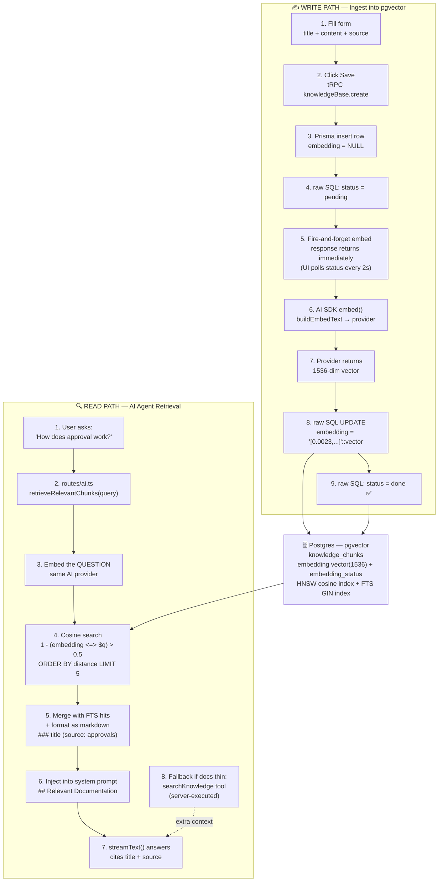
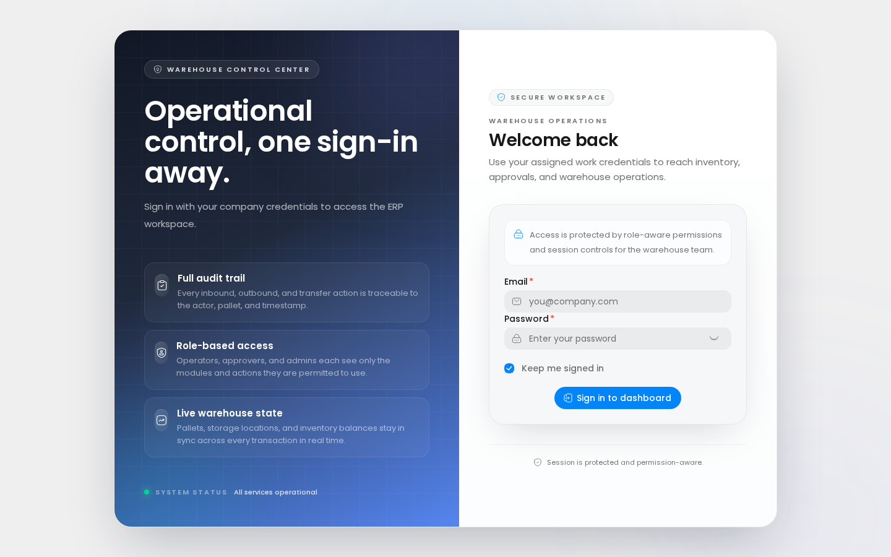

# ERP Warehouse — WMS

[](https://github.com/fathonialimukti/erp-warehouse/actions/workflows/ci.yml)
[](./LICENSE)

**Enterprise Systems That Think.** A full-stack Warehouse Management System that tracks stock movement across warehouses and storage locations in real time — receiving, putaway, picking, dispatch, returns, disposals, losses, WIP issues/completions — with approval workflows, a 3D warehouse visualizer, and an integrated AI agent.

## Stack

| Layer | Tech |
|---|---|
| Monorepo | Turborepo + Bun |
| Client | React 19, Vite, Tauri 2 (desktop + web parity), HeroUI v3, Tailwind v4, TanStack Table/Form/Query, Jotai, react-intl (EN/ID), React Three Fiber |
| Server | Express 5, tRPC v11, Prisma 7 + PostgreSQL (ULID keys), Zod v4 (`@repo/schemas`) |
| AI | Vercel AI SDK, SSE streaming, RAG (Postgres FTS + pgvector hybrid) |
| Ops | PM2 (VPS), GitHub Actions CI, settings-driven rate limiter, pino + DB system logs |

## Apps & Packages

- `apps/client` — React/Tauri client (~50 routes: transactions, inventory, reports, 3D layout, AI)
- `apps/server` — tRPC API (35+ domain routers), Express middleware, Prisma schema/migrations/seed
- `packages/schemas` — shared Zod schemas (end-to-end type safety client ↔ server)

## Architecture

Client → tRPC (`trpcClient`) → Express + Prisma → PostgreSQL (ULID keys).
AI reads the same DB via hybrid FTS + pgvector retrieval (see
`docs/adr/0001-rag-hybrid.md`). Diagram mirrors the landing showcase:



## Features

- **10 warehouse transaction types** (Oracle-aligned) with `DRAFT → PROPOSED → APPROVED/REJECTED` approval workflow + history
- **Putaway & dispatch execution** with FEFO picking (first-expiry-first-out) and atomic pallet reservation
- **Lot / expiry tracking** + expiry report (30/60/90-day buckets)
- **Cycle count (stock opname)** — blind counts, variance review, auto-generated Loss/Found adjustments
- **Purchase orders** — propose/approve, receive against PO (partial receipts, over-receipt blocked)
- **Reorder points** per SKU + warehouse, below-threshold alerts, supplier suggestions (MOQ / lead time)
- **3D warehouse layout** (R3F) — real-time pallet positioning, putaway/dispatch staging, aging view
- **AI suite** — admin chat (SSE, tool-calling), NL→SQL analytics, dashboard insights/digest, AI form fill
- **Workflow notifications + email** — approval events, reorder alerts, monthly report email (SMTP)
- **Admin log viewer** — system logs persisted to DB, live SSE tail, retention policy
- **System settings UI** — rate limiting, logging, security, mail, reports, AI config — hot-reloaded
- **Hardened auth** — JWT cookie sessions with CSRF double-submit, token revocation (`tokenVersion`), account lockout, password reset (hashed single-use tokens), admin password reset
- **Wait-queue rate limiting** — per-user/IP token buckets; requests *wait* instead of failing; transparent client auto-retry with a subtle "Waiting…" indicator
- **Command palette (Cmd+K)** with permission-aware global search; **QR barcode scanning**; printable pallet labels

## Getting started

### Install

```sh
bun install
cp apps/server/.env.example apps/server/.env   # fill DATABASE_URL + JWT_SECRET
```

### Dev

```sh
bun run dev                                    # server :10012 · client :10011
```

Database (local/dev):

```sh
bun run --cwd apps/server db:all               # generate + reset + seed (dev only — guarded)
bun run --cwd apps/server db:ensure-permissions # idempotent permission sync (safe everywhere)
bun run --cwd apps/server db:migrate:deploy     # apply migrations (production-safe)
```

### Test

Tests: `bun run test` (vitest against a real Postgres). E2E: `bun run --cwd apps/client test` (Playwright).

### Demo

Seeded captures live under [Screenshots](#screenshots) (`apps/client/public/demo/`) —
re-capture after demo users are seeded to show populated views.

## Production

```sh
bun run prod:init && bun run prod     # build + pm2 start
bun run prod:restart | prod:logs | prod:stop
```

**Required env** (see `apps/server/.env.example`): `DATABASE_URL`, `JWT_SECRET`, `CORS_ORIGIN`, optional `SMTP_*`/`MAIL_FROM`, `AI_*`, `APP_URL`. Apply pending migrations with `bun run --cwd apps/server db:migrate:deploy` and sync permissions with `db:ensure-permissions` before/after each release. System behaviour (rate limits, log retention, lockout, mail) is tuned at runtime under **System → Settings** in the app.

## Conventions

- Permissions are always `resource@action` strings; every route/action is gated server-side (`hasPermission`) and mirrored in the UI.
- Zod schemas live in `packages/schemas` and are shared by routers and client forms.
- Locales: EN + ID — run `bun sync-i18n.ts` after adding `intl.formatMessage` keys.
- Conventional Commits; `turbo run lint / check-types / test` must all pass before merging.

## Screenshots

Live captures from the running app (1440px, client `:10011` + server `:10012`).
The shared dev database currently holds inventory data but no user rows, so each
protected route below renders the live sign-in gate — re-capture
`apps/client/public/demo/` after demo users are seeded to show the populated views.


*`/warehouse` → sign-in gate (populated view: HeroUI table with search, permission-gated actions, delete confirm).*


*`/dashboard` → sign-in gate (populated view: KPI row, putaway queue, charts, secondary lists).*


*`/warehouse/:id/layout` → sign-in gate (populated view: R3F 3D pallet positioning and putaway staging).*
