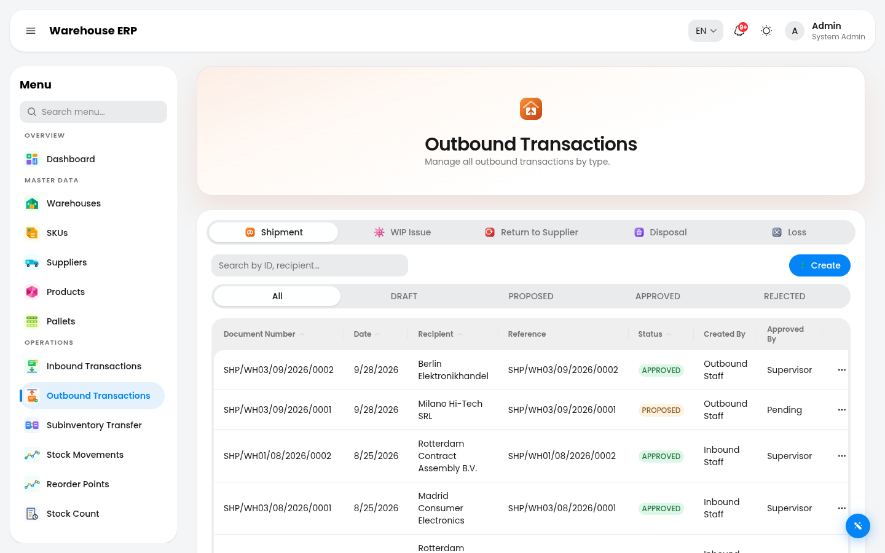
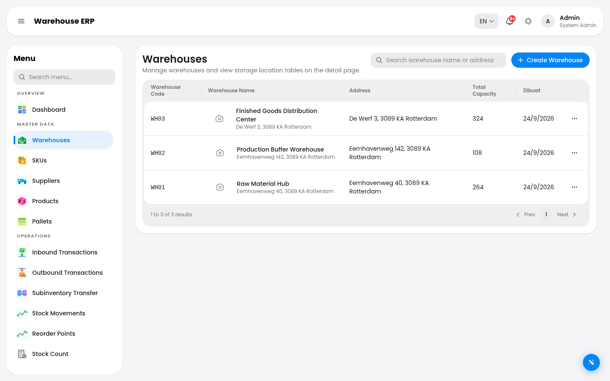

# ERP Warehouse — WMS

[](https://github.com/fathonialimukti/erp-warehouse/actions/workflows/ci.yml)
[](./CODE_OF_CONDUCT.md)
[](./LICENSE)

**Live demo: [erp-warehouse.aetherglo.com](https://erp-warehouse.aetherglo.com/)** — one-click
sign-in, sample data, nothing to configure.

<sub>
By <a href="https://aetherglo.com">Fathoni (Toni) Ali Mukti</a> — AI Engineer &amp; Full-Stack
Developer · <a href="https://www.linkedin.com/in/fathoni/">LinkedIn</a> ·
<a href="https://github.com/fathonialimukti">GitHub</a>
</sub>

A warehouse management system, built to be run and read. A Bun + Turborepo monorepo: React 19 / Vite / Tauri client, tRPC API on Express 5 with Prisma 7, PostgreSQL with ULID keys. It covers the stock lifecycle end to end — receiving, putaway, picking, dispatch, WIP issues and completions, returns to supplier, RMA, subinventory transfers, disposals, losses and found stock — with a `DRAFT → PROPOSED → APPROVED/REJECTED` approval workflow on every transaction type, enforced server-side against a 124-permission model across 10 roles. There is also a 3D warehouse view and an AI assistant that reads the same database.

The seeded dataset is 3 warehouses, 696 storage locations, 2,222 pallets, 560 stock movements, 12 months of history across 13 transaction domains, and 16 open approvals waiting in the queue. Numbers below are measured from the current database, not estimated.

## Screenshots

All captures are 1440×900, taken logged in as `admin@aetherglo.com` against the seeded dataset.


_`/dashboard` — KPI strip: 2,222 total pallets, 157 available, 16 pending approvals, 4 in the putaway queue, 4 in the dispatch queue, plus AI insights and a daily digest._


_`/outbound-transaction?tab=shipment` — 218 shipment rows, filterable by status (All / DRAFT / PROPOSED / APPROVED / REJECTED)._


_`/warehouse` — 3 of 3 warehouses, unfiltered: WH03 Finished Goods Distribution Center (324 locations), WH02 Production Buffer Warehouse (108), WH01 Raw Material Hub (264)._

Two more captures live in [`apps/client/public/demo/`](apps/client/public/demo/): `approvals.png`, the dashboard scrolled to the approval backlog (16 pending across 8 domains, 23% warehouse capacity, populated recent activity), and `storage-locations.png`, WH01's 2D storage-location table (264 locations, 56 occupied, 21% utilisation). The 3D layout viewer is described below but not pictured — it needs a GPU-backed browser, and the software-GL stack in a headless container loses the WebGL context before first paint, so I have no honest capture of it.

## What it does

**Transactions & inventory**

- 10 Oracle-aligned transaction types with a `DRAFT → PROPOSED → APPROVED/REJECTED` approval workflow and full history
- Lot and expiry tracking, with an expiry report bucketed at 30/60/90 days
- Reorder points per SKU and warehouse, with MOQ, lead time and supplier suggestions
- Blind cycle counts with variance review, generating Loss and Found adjustments automatically

**Execution**

- Putaway and dispatch with FEFO picking (expiry first, then FIFO) and atomic pallet reservation
- Purchase orders with partial receipts; cumulative over-receipt is blocked at the API
- QR and barcode scanning, printable pallet labels, PDF and Excel export

**AI**

- Admin chat over SSE with server-side tool calling
- Natural-language-to-SQL analytics
- Dashboard insights and a daily digest
- AI form fill, and RAG over Postgres — full-text search always, plus a pgvector cosine query when embeddings are configured

**Platform**

- 3D warehouse layout (`/warehouse/:id/layout`, React Three Fiber) — real-time pallet positioning, putaway and dispatch staging, aging view
- Approval notifications and email via SMTP
- System logs persisted to the database, with a live SSE tail and a retention policy
- Runtime settings UI for rate limits, logging, security, mail, reports and AI config
- JWT cookie sessions with CSRF double-submit, token revocation, account lockout, and password reset via hashed single-use tokens
- Wait-queue rate limiting: requests _wait_ their turn instead of failing, and the client retries transparently
- Command palette (Cmd+K) with permission-aware search
- EN + ID localisation, 3,272 keys each, in lockstep
- Tauri desktop shell with web parity

## Stack

| Layer    | Tech                                                                                                               |
| -------- | ------------------------------------------------------------------------------------------------------------------ |
| Monorepo | Bun 1.3.4 + Turborepo 2                                                                                            |
| Client   | React 19, Vite 8, Tauri 2, HeroUI v3, Tailwind v4, TanStack Query/Form/Table, Jotai, react-intl, React Three Fiber |
| Server   | Express 5, tRPC 11, Prisma 7 + PostgreSQL (ULID keys), Zod 4 (`@repo/schemas`)                                     |
| AI       | Vercel AI SDK 6, SSE streaming, RAG (Postgres FTS + pgvector hybrid)                                               |
| Ops      | PM2, GitHub Actions CI, settings-driven wait-queue rate limiter, pino + DB-backed system logs                      |

## Architecture

Client → tRPC (`trpcClient`) → Express 5 + Prisma 7 → PostgreSQL. Router input and output types are inferred from the server and validation schemas are shared through `packages/schemas`, so the tRPC/Zod boundary is typed in both directions — that is the part of the codebase that is strictly typed, and the one that matters most at a refactor boundary. ([ADR](docs/adr/0006-trpc-architecture.md))

40 domain routers are composed in `apps/server/src/router.ts`. Middleware runs in a deliberate order: helmet → request-id via `AsyncLocalStorage` → settings-driven wait-queue rate limiter → CSRF double-submit on mutating requests → auth → per-request access log with duration and status. Then a global error handler, a `/health` endpoint that actually probes the database, and graceful shutdown on `SIGTERM` with a 10-second force-exit cap, plus `unhandledRejection` and `uncaughtException` handlers. Client routes are lazy-loaded, so the entry chunk is 1,361 kB / 358 kB gzip and the 3D, PDF, Excel and charting libraries only load when opened.

The AI assistant reads the same database rather than a second store. Knowledge documents are split into `knowledge_chunks`; a Postgres full-text query always runs, and a pgvector cosine query is merged in when embeddings are configured and populated ([ADR](docs/adr/0001-rag-hybrid.md)). Embedding is a separate batch step (`bun run --cwd apps/server ai:embed`), not a fire-and-forget side effect of saving a document. Retrieval is best-effort by design — a failing vector search degrades to FTS-only rather than erroring the chat.

## Quickstart

Requires Bun and a reachable PostgreSQL.

```sh
bun install
```

Create the database, then copy the env template:

```sh
createdb erp_warehouse
cp apps/server/.env.example apps/server/.env
```

Edit `apps/server/.env`. The example `DATABASE_URL` is a placeholder pointing at port 4321 — change the user, password, port and database name to match what you just created. Only two variables are genuinely required: the server validates `DATABASE_URL` and `JWT_SECRET` at boot and refuses to start without them. `PORT` (default 10012) and `CLIENT_PORT` (default 10011) are optional. `CORS_ORIGIN` only applies when `NODE_ENV=production`. `AI_*` is optional, and leaving `AI_API_KEY` empty disables the AI features cleanly rather than breaking the app.

Then generate the Prisma client and load the demo dataset:

```sh
bun run --cwd apps/server db:generate
bun run --cwd apps/server db:seed
```

`db:seed` runs `prisma migrate reset --force` and then the seeder, so it drops and rebuilds the database. It refuses to run when `NODE_ENV=production`. It generates the Prisma client as part of the same command. The seed builds 12 months of history across all 13 transaction domains plus an open approval queue — override the window with `SEED_MONTHS` if you want less.

Start both apps:

```sh
bun run dev
```

Client on `:10011`, server on `:10012`. Open http://localhost:10011 and sign in with a demo account.

## Demo credentials

All seeded, all with the password `password`.

| Email                      | Role                 | Notes                                          |
| -------------------------- | -------------------- | ---------------------------------------------- |
| `admin@aetherglo.com`      | System Admin         | 119 permissions — sees everything              |
| `manager@aetherglo.com`    | Warehouse Manager    | 89 permissions                                 |
| `supervisor@aetherglo.com` | Warehouse Supervisor | 38 permissions                                 |
| `staff@aetherglo.com`      | Auditor              | 28 permissions — create buttons visibly absent |
| `inbound@aetherglo.com`    | Receiver             | 17 permissions                                 |
| `outbound@aetherglo.com`   | Picker               | 15 permissions                                 |
| `inventory@aetherglo.com`  | Cycle Counter        | 23 permissions                                 |

`staff@` is the useful one for a permissions demo: the Auditor role is read-only, so the difference is visible without reading a single line of code. Set `DEMO_LOGIN_ENABLED=true` to get one-click "login as" cards on the sign-in page.

## Tests & quality gates

What CI runs on every push and pull request, all currently green as of 2026-09-29:

| Gate   | Command                                    | Result                                                 |
| ------ | ------------------------------------------ | ------------------------------------------------------ |
| Lint   | `bun run lint`                             | clean, `eslint --max-warnings 0` in all 3 packages     |
| Format | `bunx prettier --check "**/*.{ts,tsx,md}"` | clean                                                  |
| Types  | `bun run check-types`                      | clean, 3/3 packages                                    |
| Tests  | `bun run test`                             | server 58 files / 257 tests, client 3 files / 14 tests |
| Build  | `bun run build`                            | clean, client entry chunk 1,361 kB / 358 kB gzip       |

The server suite runs against a real PostgreSQL database, not mocks — CI spins up a `postgres:16` service. One file snapshots and destructively restores every table, so files run serially by design. Playwright end-to-end specs live in `apps/client/src/tests/e2e/` and run separately: `bun run --cwd apps/client test:e2e`.

Server coverage runs under v8 with thresholds pinned in `apps/server/vitest.config.ts` at the level the suite actually achieves today (50% statements, 49% functions, 39% branches, 51% lines), so a regression fails the run. They are a ratchet, not a target — an aspirational number would leave the build permanently red and teach everyone to ignore it.

**Known open issues.** `bun audit` reports 39 advisories: 24 high, 13 moderate, 2 low, 0 critical. Most are build- and CLI-time only — Prisma's own transitive dependencies and Express's pinned `qs` / `body-parser` — and never load into the served runtime. Two are real client-runtime risk and are still open: `react-router@7.16.0` (5 advisories, fixed at ≥ 7.18.2) and `xlsx@0.18.5` (2 high, no published fix, because SheetJS moved its releases off npm). [`SECURITY.md`](SECURITY.md#known-limitations) has the full breakdown of which findings are reachable. There are no secrets committed to the repo.

## Project layout

```
apps/client/            React + Vite + Tauri client, 91 route entries, EN/ID locales, e2e specs
apps/server/            tRPC API (40 domain routers), Express middleware, Prisma schema + migrations + seed
packages/schemas/       Shared Zod validation schemas, imported by both routers and client forms
docs/adr/               Architecture decision records
docs/design/            Design tokens, components, accessibility
docs/ops/               Runbooks, monitoring, backup/restore, privacy
```

## Docs

- [`PRODUCT.md`](PRODUCT.md) — what the system does, domain by domain
- [`CONTRIBUTING.md`](CONTRIBUTING.md) — commit and PR conventions
- [`SECURITY.md`](SECURITY.md) — threat model, controls, and known limitations
- [`CHANGELOG.md`](CHANGELOG.md) — hand-maintained, newest first
- [`docs/`](docs/) — ADRs, design system, operations runbooks

## License

[MIT](LICENSE) © 2026 ERP Warehouse contributors
